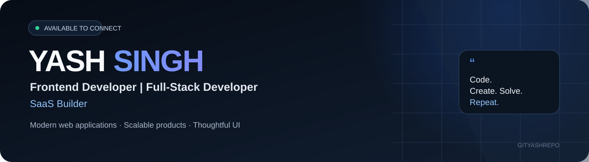
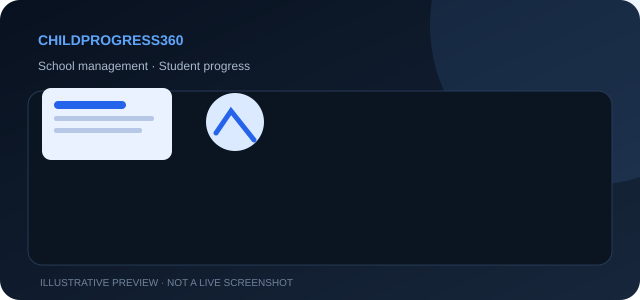
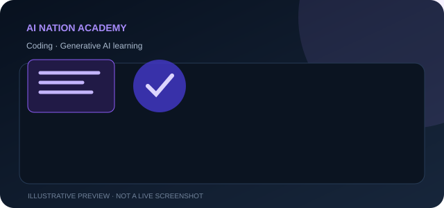
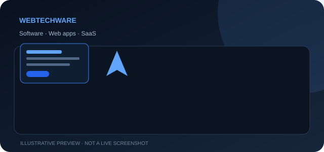
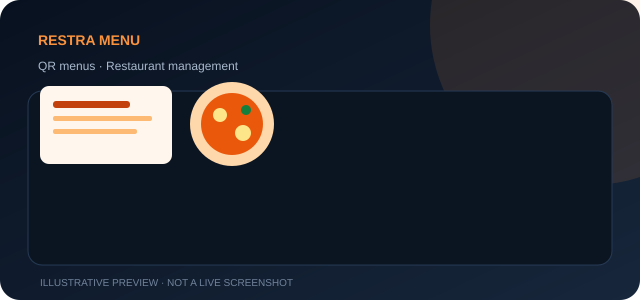

  
  
  
  

**I build modern web applications, scalable SaaS products, and thoughtful digital experiences.**

---

## About me

I'm Yash Singh, a developer focused on building clean, responsive web experiences and practical software products. I work across frontend interfaces, full-stack applications, and SaaS product development.

- **Focus:** React, Next.js, UI engineering, and SaaS products
- **Backend:** Node.js, Express, MongoDB, and API integrations
- **Interested in:** Frontend architecture, performance, useful AI integrations, and product development
- **Open to:** Freelance projects, collaborations, and suitable full-time opportunities

> **Code. Create. Solve. Repeat.**

## Featured projects

<table>
  <tr>
    <td width="50%" valign="top">
      
      <h3>ChildProgress360</h3>
      A school-management and student-progress platform designed to help schools manage educational workflows.
        
      <b>Stack:</b> Next.js · Node.js · MongoDB
        
      <a href="https://childprogress360.webtechware.in">↗ Live website</a>
    </td>
    <td width="50%" valign="top">
      
      <h3>AI Nation Academy</h3>
      An educational product focused on coding and generative-AI learning for students.
        
      <b>Stack:</b> Next.js · React · AI learning tools
        
      <a href="https://ainationacademy.com">↗ Visit website</a>
    </td>
  </tr>
  <tr>
    <td width="50%" valign="top">
      
      <h3>WebTechWare</h3>
      A software-development brand delivering websites, SaaS solutions, and digital products.
        
      <b>Focus:</b> Web apps · SaaS · Product development
        
      <a href="https://webtechware.in">↗ Visit website</a>
    </td>
    <td width="50%" valign="top">
      
      <h3>Restra Menu</h3>
      A restaurant SaaS concept for QR menus, admin workflows, and sales reporting.
        
      <b>Focus:</b> QR menus · Restaurant tools · Reporting
        
      <a href="mailto:singhyash3012@gmail.com?subject=Restra%20Menu%20project">↗ Ask me about this project</a>
    </td>
  </tr>
</table>

## Tech stack

  

  
<b>More about my toolkit</b>

   
  <table>
    <tr><td><b>Frontend</b></td><td>React.js, Next.js, JavaScript, TypeScript, HTML, CSS, Tailwind CSS, Shadcn UI</td></tr>
    <tr><td><b>State & animation</b></td><td>Redux Toolkit, Framer Motion, GSAP</td></tr>
    <tr><td><b>Backend & data</b></td><td>Node.js, Express.js, MongoDB, Mongoose, REST APIs</td></tr>
    <tr><td><b>Tools & deployment</b></td><td>Git, GitHub, Vercel, Railway</td></tr>
  </table>

## GitHub at a glance

  
  

  

> Statistics and activity graphs are provided by third-party services and may occasionally be unavailable or delayed. Language charts reflect public repository data and may not represent every technology I use.

## What I do

<table>
  <tr>
    <td width="50%" valign="top">
      <h3>⌘ Frontend development</h3>
      Responsive interfaces, reusable components, and accessible user experiences.
    </td>
    <td width="50%" valign="top">
      <h3>⬡ Full-stack development</h3>
      Web applications with Node.js, Express, MongoDB, and API integrations.
    </td>
  </tr>
  <tr>
    <td width="50%" valign="top">
      <h3>◈ SaaS product development</h3>
      Product workflows, dashboards, admin portals, and deployment.
    </td>
    <td width="50%" valign="top">
      <h3>↗ Integrations & performance</h3>
      Third-party APIs, payment integrations, and practical performance improvements.
    </td>
  </tr>
</table>

## Current focus

- Building useful web products with React and Next.js
- Improving frontend architecture, maintainability, and performance
- Developing practical SaaS products from interface to deployment
- Exploring modern tools and AI integrations where they add real value

## Let's connect

Have a project in mind, want to collaborate, or just want to talk tech?

  
Thanks for visiting my profile. <b>Code. Create. Solve. Repeat.</b>

